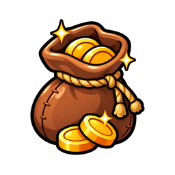

# 상점 — Crime Scene 선반 (컴포넌트 스펙)

시안: `Redesigning_art_style_for_shop_20261018031705.jpg`. 토큰: [tokens.json](tokens.json). 프로토타입: [shop-prototype.html](shop-prototype.html).
게임 본체와 같은 **16:9 스테이지**(`container-type: size`, 단위 `cqw` · `cqh`) 안에서 그리므로 휴대폰 가로 어떤 크기든 비율이 같다.

## 레이어 구조
```
.stage (16:9, 컨테이너 쿼리 기준)
├─ .wall            벽돌 벽 + 어두운 비네트 (배경)
├─ .tape.left / .tape.right   CRIME SCENE 폴리스 라인 (좌우를 감싸며 살짝 기울어짐)
├─ .frame           철제 외곽 빔 4변 + 모서리 나사
├─ header.topbar    [네온 간판 '상점'] [탭 ×5] [닫기 ×]
├─ .shelves         선반 2단 (각 단 = .shelf-beam + .products)
│   └─ .product ×4  아이콘 / 종이 가격표 / $ 버튼
├─ .lamp            우측 빈티지 알전구 (케이지 + 전구 + 글로우)
└─ .cables          천장 케이블 (장식)
```

## 1. 네온 간판 `.sign`
- 철판(`steel-plate`) 위 네온 글자. 글자색 `neon.yellow-core`, 테두리 `neon.yellow`, `text-shadow: shadow.neon-text`.
- `@keyframes neon-flicker` 6초 주기로 밝기 0.85~1 미세 깜빡임 (prefers-reduced-motion 이면 없음).
- 철판 모서리 4개 나사 (`.rivet`).

## 2. 탭 `.tab` (Top Navigation)
| 상태 | 배경 | 테두리 | 글자 | 기타 |
|---|---|---|---|---|
| 기본 | `paper.tab` + paper-texture | 1px `paper.shadow` | `paper.ink` | 살짝 기울임(-1.5° / 1° 번갈아), 상단 집게 |
| 활성 | `paper.tab-active` | `shadow.neon-box` (노란 네온) | `paper.ink` | 기울임 0°, 2px 위로, 집게 노랑 |
| 눌림 | — | — | — | `translateY(2px)` |
- 집게(`.tab::before`): 상단 중앙 작은 철제 클립. 활성 탭은 `accent.gold`.
- 탭 위 작은 라벨(`.tab small`)은 시안의 '단서 코인' 같은 메모 — 선택.

## 3. 선반 `.shelf`
- 빔 `.shelf-beam`: 높이 `4.5cqh`, `material.steel-texture` + `shadow.shelf`, 양 끝 · 1/3 · 2/3 지점에 나사.
- 빔 아래 그림자 띠(`::after`)로 상품이 선반 위에 놓인 입체감.
- 상품 4개가 빔 위에 `align-items: flex-end` 로 서 있다 (아이콘 바닥이 빔에 닿음).

## 4. 상품 카드 `.product`
```
<article class="product" data-id="coin_tier_02">
  <span class="badge-best">베스트</span>              ← 선택
     ← 기존 에셋 경로 (비워 둠)
  <div class="price-paper">
    <div class="name">골드 주머니</div>
    <div class="gold"><i class="coin"></i>2,200</div>
    <span class="bonus">보너스 +10%</span>            ← 없으면 '기본' (회색)
  </div>
  <button class="buy-btn">$1.99</button>
</article>
```
- `product-icon`: 높이 `22cqh`, 바닥 정렬, `drop-shadow`. 시안의 '동전 주머니 · 골드 상자 · 골드 금고' 등은 **TODO: Higgsfield 생성** 주석.
- `price-paper`: 구겨진 종이 (`material.paper-texture` + `shadow.paper` + `shadow.paper-inset`), 살짝 기울임, 상단 테이프 조각(`::before`).
- `bonus`: 초록 알약 (`accent.green`), 글자 흰색. `bonus.none` 은 회색 '기본'.
- `buy-btn`: 철판 버튼 (`material.steel-texture` + `shadow.steel-plate`), 좌우 나사, 글자 `font.display`. hover 밝아짐, active 눌림.
- `badge-best`: 빨간 리본 (`accent.red`), -4° 기울임, 아이콘 위에 겹침.

## 5. 장식
- `.tape`: `material.police-tape` 띠 위에 'CRIME SCENE · DO NOT CROSS' 반복 글자(검정), 좌우 -70°/+70° 회전해 화면 가장자리를 감싼다. `pointer-events: none`.
- `.lamp`: 케이지(세로선 4개 + 링 2개) 안 전구. 전구 `lamp.bulb` + `shadow.lamp-glow`, 2.5초 주기 미세 호흡.
- `.rivet`: 지름 `1.6cqh`, `radial-gradient(circle at 35% 35%, rivet, rivet-shadow)`, 한 줄 홈(`::after`).

## 6. 반응형
- 스테이지가 16:9 를 유지하므로 폰 가로(915×412)에서 자동 축소. 글자는 `clamp()` 로 최소 크기 보장(가격 14px, 상품명 12px).
- 스테이지 폭 < 700px: 탭 글자 줄이고 '베스트' 리본 축소. 세로 화면: "기기를 가로로 돌려 주세요" 안내.

## 7. 게임 본체 연동 (다음 단계)
- 상품 데이터는 `js/shop.js` 의 `TP.SHOP_PRODUCTS` / `TP.SHOP_CATEGORIES` 그대로. 프로토타입의 `PRODUCTS` 는 그 구조를 흉내 낸 샘플.
- 아이콘은 `TP.productImage(p)` → `assets/shop/<id>.png` 규칙으로 통일하면 교체가 쉽다.
- 적용 시 `css/shop-crime.css` 로 분리하고 `#shopModal` 의 `.modal.shop` 안에 같은 클래스 구조를 넣는다.
